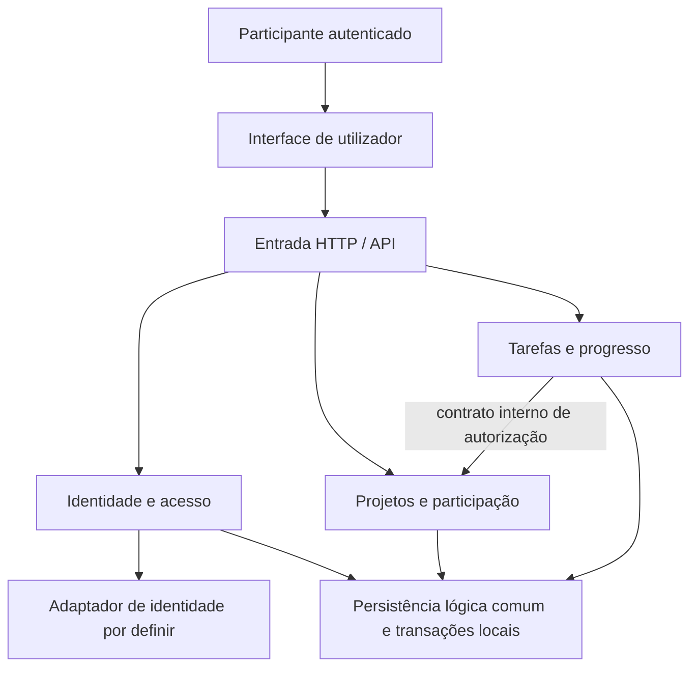

# Matriz — Arquitetura das fichas 02 e 03

## Arquitetura implementada — ficha 03

Decisões aprovadas pelo autor em 29-10-2026: monólito modular mantido; Java 21/Spring Boot 3.5, React/TypeScript/Vite, PostgreSQL 17 e Flyway. JDBC é usado com parâmetros preparados; não há ORM, serviços distribuídos ou persistência em memória.

| Componente | Implementação e responsabilidade |
|---|---|
| Interface | `frontend/src/App.tsx`, `Layout.tsx`, `Projects.tsx`, `Tasks.tsx`: login, estrutura partilhada, painel, projetos, detalhe de projeto/tarefa; cliente `api.ts` e estados comuns em `ui.tsx`. |
| Identidade | `backend/.../identity`: Spring Security OAuth2 Client/OIDC com Keycloak, sessão no servidor, perfil e logout local. Claim `app_user_id` ligado a conta local ativa, verificada em cada operação de negócio. |
| Projetos | `backend/.../projects`: propriedade, participação, CRUD, pesquisa, paginação, autorização e contagens globais. |
| Tarefas | `backend/.../tasks`: CRUD, estado/prioridade, filtros, atribuições N:M e comentários, com autorização pelo contrato interno do módulo projetos. |
| Transversal | `backend/.../common`: DTOs tipados, erros Problem Details, validação Unicode e paginação. |
| Persistência | Migration Flyway e PostgreSQL com FKs/restrições; transações locais, bloqueio de projeto nas escritas e versão otimista. |
| Entrega | Dockerfile multi-stage compila React e inclui o resultado no JAR. Compose executa aplicação e PostgreSQL com volume persistente. Vite separado apenas em desenvolvimento. |

### Identidade e ciclo de acesso

O login atual usa OIDC Authorization Code com Keycloak. O servidor valida o ID token e só aceita o claim assinado `app_user_id` quando corresponde a um perfil local ativo; não cria perfis automaticamente. O identificador interno é obtido exclusivamente deste claim autenticado, nunca de um pedido de negócio.

Compose fornece Keycloak e realm fictício local. O issuer público do navegador é `http://localhost:8180/realms/matriz`; as chamadas back-channel do container da aplicação usam `http://keycloak:8080/realms/matriz`. `GET /api/auth/login` inicia o redirecionamento; o callback OIDC cria a sessão Matriz no servidor. Mantêm-se cookie HttpOnly/SameSite Strict, sessão renovada no login, expiração inativa de 30 minutos, CSRF nas escritas e `COOKIE_SECURE=true` com HTTPS fora da demonstração. O logout invalida a sessão Matriz, não a sessão independente do Keycloak. Não há CORS aberto nem localStorage com segredos.

#### Implementação anterior ao OIDC — histórico

O Bearer preliminar da ficha 02 foi substituído, com autorização do autor, por sessão Spring Security: cookie HttpOnly/SameSite Strict, sessão renovada no login, expiração inativa de 30 minutos, invalidação no logout. `COOKIE_SECURE=true` é obrigatório com HTTPS fora da demonstração local. O frontend usa mesma origem/proxy; não há CORS aberto, localStorage com segredos ou identidade inferida de valores enviados pelo cliente.

`GET /api/auth/csrf` fornece token; `X-CSRF-TOKEN` protege login e todas as escritas. O cliente obtém token atual antes de cada escrita, incluindo após login/logout. O backend obtém proprietário e autor do Principal; nunca aceita esses campos como prova de identidade.

### Dados, autorização e consistência

Todas as escritas de um projeto bloqueiam a respetiva linha durante a transação. A autorização é verificada no mesmo contexto da gravação; isso serializa remoções/atribuições concorrentes. Recursos alheios/inexistentes recebem 404, membros sem gestão recebem 403. Sessões não armazenam permissões por projeto em cache.

Edições de projeto/tarefa exigem versão; tarefas também a exigem nas atribuições e eliminações. FKs asseguram pertença ao mesmo projeto e unicidade. Projeto tem participação do gestor assegurada por FK composta diferível. Eliminações confirmadas removem dependentes na transação; falha reverte o conjunto.

Listagens de projetos/tarefas usam retrato `REPEATABLE_READ`; o progresso conta todas as tarefas do projeto, não a página ou filtros. `pagination.totalItems` de tarefas conta o subconjunto filtrado, portanto pode diferir de `progress.total`. Ordenação: criação ascendente e id ascendente.

Frontend desativa a submissão e tem guarda síncrona contra duplicados; conserva texto em falhas e atualiza dados após resposta confirmada. Uma falha de transporte não prova rollback: é apresentada incerteza e não há repetição automática de escritas.

### Organização visual aprovada

Tema escuro/azul com referência visual no [Black Dashboard React](https://github.com/creativetimofficial/black-dashboard-react), mantendo React/TypeScript/Vite e sem importar código, assets ou dependências do template. Por decisão posterior do autor, a estrutura segue um espaço de trabalho ao estilo Jira: barra superior global, navegação lateral compacta, breadcrumbs, links entre vistas e tabelas de projetos/tarefas.

`Layout.tsx` partilha navegação, perfil e saída; em telemóvel usa um `<dialog>` modal nativo com fecho por Escape e mudança de rota. O atalho para o conteúdo mantém a rota hash e o conteúdo focado não fica sob a barra fixa. Formulários, rascunhos, autorização e chamadas à API mantêm as regras existentes.

O painel representa a distribuição atual dos três estados do projeto selecionado, usando os seus agregados globais devolvidos pela API. A seleção corresponde aos projetos da página/pesquisa atual; não se apresentam somas dessa página como totais globais nem séries temporais inexistentes. Não há novas capacidades de Jira, quadros ou sprints.

### Revisão e limites

API completa da demonstração em [openapi.yaml](../openapi.yaml); plano/resultados em [implementation-plan.md](implementation-plan.md) e [verification.md](verification.md). O wireframe da ficha 02 é histórico; interface real inclui prioridade, responsáveis múltiplos e comentários.

Continuam fora do âmbito registo público, recuperação de palavra-passe, anexos, notificações, sprints e operação pública. Não foram assumidas escalabilidade ou conformidade. Não se reivindica certificação de segurança; políticas corporativas, limitação de tentativas, HTTPS, logs/monitorização e recuperação devem ser tratados antes de produção.

Architecture Pack original da ficha 02 — preservado como histórico; contrato parcial e responsável único foram substituídos

## 1. Contexto e estado

Este documento responde aos exercícios 1 e 5 da Ficha Prática Laboratorial 02. O objetivo é conceber a solução do MVP, não implementar código funcional.

Base de requisitos: [requirements.md](requirements.md), [user-stories.md](user-stories.md) e [constraints.md](constraints.md). O Specification Pack foi versionado manualmente pelo autor no commit `c13da97` (`docs: Specification Pack`), observado em `main` e `origin/main` no início desta atividade.

O autor escolheu **monólito modular** para este exercício e autorizou este Architecture Pack. As regras de negócio continuam a ser pressupostos de desenho sujeitos a validação com o cliente. A autorização não resolve automaticamente as questões Q-01 a Q-10 nem autoriza implementação ou exploração com dados reais.

## 2. Comparação de alternativas

| Alternativa | Benefícios neste MVP | Custos e limitações | Adequação |
|---|---|---|---|
| Monólito simples | Uma aplicação e operação inicial simples. | Fronteiras menos explícitas facilitam mistura de permissões, tarefas e persistência. | Viável, mas oferece menos orientação para evolução. |
| Monólito modular | Uma implantação; módulos com responsabilidades claras; transações locais para regras que atravessam participação e tarefas. | Requer disciplina nas dependências; a aplicação é entregue e dimensionada em conjunto. | Escolhida: equilibra simplicidade e organização. |
| Microserviços | Possibilidade de entregas e escala independentes. | Rede, autenticação entre serviços, consistência distribuída, observabilidade e operação adicionais; benefício não demonstrado. | Não justificada pelo âmbito e contexto disponíveis. |

Não foram confirmados tamanho da equipa, orçamento, volume ou metas de disponibilidade. A escolha apoia-se no âmbito funcional pequeno e na ausência de necessidades demonstradas de distribuição, não em números inventados. Rever se esses fatores mudarem.

## 3. Decisão e consequências

**DEC-01 — Monólito modular, escolhido pelo autor para a ficha 02.** Uma aplicação implantável, organizada por capacidades, com uma interface de utilizador, uma API e uma persistência lógica comum. Não são especificados processos frontend separados, fornecedor cloud ou um motor de base de dados.

**Propostas de desenho que suportam a decisão:**

- **DES-01:** persistência com modelo relacional lógico e transações locais, sem escolher SGBD, SQL, ORM ou migrations.
- **DES-02:** identificadores opacos representados como texto nos contratos, sem impor UUID ou inteiro; metadados de criação/alteração e versão de tarefa para consistência.
- **DES-03:** API REST parcial em OpenAPI 3.1. O acesso Bearer opaco é uma convenção preliminar do contrato autorizada pelo autor; não pressupõe JWT, fornecedor, fluxo de login ou armazenamento de credenciais.
- **DES-04:** wireframe desktop estático e de baixa fidelidade, sem escolher framework ou design system.

Estas propostas não são requisitos originais do cliente. Devem ser revistas antes da ficha 03. A consequência principal de DEC-01 é manter transações e operação simples, aceitando que os módulos não têm deploy independente.

## 4. Componentes e responsabilidades

| Componente | Responsabilidade | Limites |
|---|---|---|
| Interface | Apresentar projetos, tarefas, estados e progresso; recolher entradas e apresentar falhas. | Não decide autorização e não é a fonte de verdade das contagens. |
| Entrada HTTP/API | Interpretar pedidos, obter identidade, validar o contrato e traduzir resultados/erros. | Não contém regras de participação ou progresso duplicadas. |
| Identidade e acesso | Resolver a identidade e o estado ativo da conta através de um adaptador a definir. | Não escolhe agora o fornecedor nem cria registo público. |
| Projetos e participação | Criar projetos e participação inicial, consultar contexto e gerir membros e permissões. | É dono dos dados de projeto/participação; não altera tarefas diretamente. |
| Tarefas e progresso | Criar, consultar e editar tarefas; controlar responsável, estados, versão e agregados. | Obtém autorização pelo contrato interno de participação, não por regras próprias divergentes. |
| Persistência e coordenação transacional | Guardar dados e executar operações atómicas, restrições e consultas consistentes. | Um armazenamento lógico comum não autoriza acesso arbitrário aos dados de outros módulos. |

Não existe um módulo separado de relatórios, comentários, notificações ou sprints. Progresso é uma consulta derivada das tarefas.

O diagrama representa dependências lógicas, não serviços ou implantações independentes. A aplicação fornece casos de uso que coordenam os módulos na mesma transação, sem expor os seus repositórios como API pública.

## 5. Fluxos e consistência

### Consultar tarefas e progresso

1. Validar autenticação e conta ativa.
2. Verificar a participação no projeto sem revelar projetos alheios.
3. Ler contexto, tarefas paginadas, total e agregados no mesmo retrato consistente dos dados.
4. Responder com a página e com progresso calculado sobre todas as tarefas desse projeto, não só as visíveis.

### Criar tarefa

1. Resolver a identidade e verificar participação.
2. Normalizar espaços nas extremidades do título e validar os limites após essa normalização.
3. Na mesma transação que valida o acesso, criar tarefa em `TODO`, sem responsável e com versão inicial 1.
4. Confirmar sucesso apenas após persistência; uma transação falhada não deixa tarefa parcial.

### Alterar atribuições, remover membros e editar tarefas

Estas operações pertencem ao MVP, mas não às duas operações OpenAPI desta ficha. Os contratos ficam para expansão posterior.

Verificação de participação, elegibilidade do responsável e escrita devem ser atómicas. Serializar por projeto as alterações de participação/atribuição que possam competir; isto impede que uma remoção autorizada concorra com uma atribuição e deixe uma referência inválida. A aplicação não deve fazer apenas uma verificação fora da transação e gravar mais tarde.

Toda a alteração da tarefa verifica a versão lida e incrementa-a quando muda dados. Uma edição desatualizada é recusada sem sobreposição; repetir o mesmo estado ou responsável mantém o resultado e não duplica dados. O mecanismo concreto de bloqueio/controlo otimista depende do SGBD futuro.

Uma falha de transporte depois de um commit pode deixar o resultado desconhecido para o cliente. Não prometer que não houve gravação nem repetir automaticamente um POST: consultar os dados e informar a incerteza. Idempotência de criação pode ser avaliada numa expansão, mas não foi adicionada como funcionalidade aprovada.

## 6. Contrato parcial e wireframe

O [openapi.yaml](../openapi.yaml) documenta:

| Operação | Cobertura direta | Observação |
|---|---|---|
| `GET /projects/{projectId}/tasks` | US-05, US-09 e contexto mínimo de US-03 | Página de tarefas, contexto do projeto e progresso global; sem pesquisa ou filtros. |
| `POST /projects/{projectId}/tasks` | Criação de US-05 | Apenas título e descrição; estado e responsável iniciais definidos pelo sistema. |

Autenticação e restrição de acesso de US-01/US-03 aplicam-se às duas operações. O pack **não contém uma API completa do MVP**: criar/listar projetos, gerir membros, autenticar, terminar acesso, editar tarefa, gerir responsável e mudar estado exigirão contratos adicionais.

O [wireframe PNG](ui/wireframe.png), com [fonte SVG](ui/wireframe.svg), mostra o detalhe do projeto “Alfa”, cinco tarefas e 40% concluído. Usa apenas dados fictícios e explicita o estado inicial do formulário de criação. “Projetos”, “Membros” e “Ver” são destinos de navegação previstos, não chamadas já contratadas ou implementadas.

O desenho inclui estados alternativos de carregamento, vazio e erro como notas, não como dados simultâneos do mesmo ecrã. Uma representação estática não comprova acessibilidade, navegação por teclado, responsividade ou comportamento de erro em execução.

## 7. Exercício 5 — Revisão crítica

Pedido aplicado à proposta: identificar omissões ou contradições entre requisitos, arquitetura, modelo, API e wireframe, sem aumentar o MVP nem tratar exemplos da aula como decisões do cliente.

| Observação | Tratamento fundamentado |
|---|---|
| “Gestor” global contradiria os perfis por projeto. | Derivar o perfil do proprietário do projeto; participação é local ao projeto. Não criar um administrador global. |
| Relação N:M entre pessoas e tarefas contrariaria responsável único. | Usar responsável opcional e referência à participação do mesmo projeto, não uma tabela de atribuições múltiplas. |
| Contar só a página visível distorceria o progresso. | Resposta GET separa paginação de agregados globais; ambos vêm de um retrato consistente. |
| Validar `maxLength` do título bruto rejeitaria entradas válidas após remoção de espaços. | Pedido valida presença de texto e documenta limite após normalização; resposta limita o título normalizado a 200 pontos de código. |
| Estado ou responsável editáveis na criação contradiriam RN-05. | POST não aceita esses campos; o wireframe apresenta-os apenas como valores iniciais informativos. |
| Eliminar participação poderia invalidar atribuições ou remover o gestor. | Restrição lógica/transacional e recusa de remoção, também para tarefas concluídas; sem eliminação em cascata. |
| Uma API de duas operações não suporta todos os botões do MVP. | Limite explicitado; wireframe identifica navegação futura. Não inventar endpoints completos para aparentar cobertura. |
| Incluir comentários, prioridade ou datas copiaria funcionalidades futuras. | Rejeitar esses campos e controlos neste pack; manter as exclusões da ficha 01. |
| Escala, identidade e ciclo de vida continuam desconhecidos. | Manter Q-03/Q-08/Q-09 abertas; não afirmar arquitetura pronta para produção nem conformidade legal. |

Esta é uma auto-revisão fundamentada da IA. Depois de apresentados os artefactos e o wireframe, o autor aceitou a triagem: responsável único, exclusão de funcionalidades futuras, API parcial e manutenção das questões de identidade, escala e privacidade em aberto. Essa aceitação não é confirmação pelo cliente nem demonstração do comportamento de uma aplicação.

## 8. Validação e passagem à ficha 03

Verificações documentais efetuadas:

- YAML lido sem chaves duplicadas, com exatamente duas operações e 31 referências locais resolvidas.
- Catorze exemplos de pedidos/respostas verificados contra os tipos, campos obrigatórios, limites, padrões e alternativas presentes nos respetivos schemas.
- Valores iniciais, campos não permitidos no POST, limites do título após normalização e exemplos de progresso 0/0, 1/3, 2/3, 1/8, 2/5 e 5/5 verificados.
- Quatro entidades e cinco relações do ER conferidas estruturalmente e por leitura; correspondência com o responsável opcional, participação do gestor e regras de integridade revista.
- Ligações locais e blocos Markdown conferidos; ficheiros de requisitos e User Stories mantidos iguais aos da ficha 01 em `main`.
- PNG de 1440 × 1120 gerado localmente a partir da fonte SVG, integridade verificada e apresentação inspecionada visualmente; tarefas e contagens coincidem com o exemplo GET.
- SVG aberto no painel de pré-visualização; as onze eliminações originalmente staged foram preservadas, sem adicionar ficheiros ao índice.

Limitações: as verificações locais de OpenAPI são estruturais e dos exemplos, não certificação por um validador completo de OpenAPI 3.1/JSON Schema. O Mermaid foi revisto como texto, mas não renderizado por um motor Mermaid. Não houve instalação de dependências nem testes de servidor, base de dados, autorização ou acessibilidade de uma aplicação, pois não existe implementação.

Checklist: arquitetura justificada, modelo/ER, duas operações OpenAPI, wireframe e pressupostos estão documentados; a triagem crítica foi aceite pelo autor. Permanecem necessárias revisão integral pelo responsável e validação com o cliente.

Permanecem pendentes: validação humana final, questões do cliente, stack, SGBD, identidade, contratos restantes, medições de escala e estratégia de operação. Os novos artefactos só ficam versionados quando houver um commit autorizado; o commit `c13da97` cobre a ficha 01, não esta ficha.

