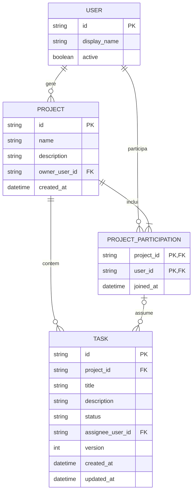

# Matriz — Modelo lógico de dados e diagrama ER

## 1. Estado e princípios

Exercício 2 da ficha 02. Modelo lógico proposto para o [MVP](requirements.md), alinhado com a [arquitetura](architecture.md). Não existe base de dados criada, SQL, migrations ou motor escolhido.

As cardinalidades seguem os pressupostos P-01 a P-10 de [constraints.md](constraints.md), não uma aprovação do cliente. Os identificadores são opacos; `string` representa texto conceptual, não uma escolha física de coluna. Datas representam instantes; a API usa representação UTC.

## 2. Entidades e atributos

| Entidade | Atributos conceptuais | Justificação |
|---|---|---|
| USER | `id` (PK), `display_name` (texto obrigatório), `active` (booleano obrigatório). | Identificar participantes e verificar elegibilidade, RF-01/RF-04. |
| PROJECT | `id` (PK), `name` (texto 1–120 após normalização), `description` (texto até 2 000, vazio se omitido), `owner_user_id` (FK obrigatória para USER), `created_at` (instante). | Organizar trabalho e identificar o único gestor, RF-02/RF-03. |
| PROJECT_PARTICIPATION | `project_id` (PK/FK para PROJECT), `user_id` (PK/FK para USER), `joined_at` (instante). | Relação N:M entre projetos e utilizadores, incluindo o gestor, RF-04. |
| TASK | `id` (PK), `project_id` (FK obrigatória), `title` (texto 1–200 após normalização), `description` (texto até 2 000, vazio se omitido), `status` (TODO/IN_PROGRESS/DONE), `assignee_user_id` (opcional), `version` (inteiro positivo), `created_at` e `updated_at` (instantes). | Trabalho, responsável único, estados e concorrência, RF-05 a RF-08. |

`display_name` não é um identificador único. Não se impõem nomes únicos a projetos ou tarefas. Os valores iniciais de TASK são `TODO`, responsável ausente e versão 1; os restantes metadados são gerados pela aplicação.

Não se modelam email, palavra-passe, token, anexos, comentários, prioridade, datas-limite ou sprints. A ligação entre USER e o mecanismo de identidade/estado ativo ainda deve ser definida em Q-03; esta projeção de utilizador não implementa autenticação.

O papel no projeto é derivado: se `PROJECT.owner_user_id` corresponde à pessoa, é gestor; os restantes participantes são membros. Não se guarda uma coluna de papel que possa contradizer o proprietário.

## 3. Relacionamentos e cardinalidades

| Relação | Cardinalidade e obrigatoriedade |
|---|---|
| USER gere PROJECT | Um utilizador gere zero ou muitos projetos; cada projeto tem exatamente um gestor. |
| PROJECT contém PROJECT_PARTICIPATION | Um projeto tem uma ou mais participações, incluindo a do gestor; cada participação pertence a um projeto. |
| USER tem PROJECT_PARTICIPATION | Um utilizador tem zero ou muitas participações; cada participação refere exatamente um utilizador. |
| PROJECT contém TASK | Um projeto tem zero ou muitas tarefas; cada tarefa pertence exatamente a um projeto. |
| PROJECT_PARTICIPATION assume TASK | Uma participação pode ser responsável por zero ou muitas tarefas do seu projeto; uma tarefa tem zero ou uma participação responsável. |

## 4. Diagrama ER em Mermaid

A relação de responsável é composta: `(TASK.project_id, TASK.assignee_user_id)` referencia `(PROJECT_PARTICIPATION.project_id, PROJECT_PARTICIPATION.user_id)`. A marca FK em `assignee_user_id` não significa uma referência isolada a qualquer utilizador. Se não há responsável, só `assignee_user_id` está ausente; a tarefa continua a ter projeto.

## 5. Integridade e transações

- Chaves primárias únicas e não nulas; participação única pelo par `(project_id, user_id)`.
- Todo o proprietário tem de ter participação no seu próprio projeto. Criar PROJECT e a participação inicial numa única transação. A inclusão do proprietário é uma invariável adicional que uma simples FK para USER não garante.
- A referência composta do responsável impede atribuições a outro projeto; verificar também que a conta está ativa no momento da atribuição, pois uma FK não garante elegibilidade.
- A inatividade posterior de uma conta não elimina automaticamente a participação ou atribuições históricas. Impede o acesso e novas atribuições; o gestor pode retirar/substituir a atribuição para remover a participação. Não se inventa uma transferência automática.
- Recusar a remoção de uma participação referenciada por qualquer tarefa, incluindo concluída; recusar sempre a remoção do gestor.
- Serializar operações concorrentes sobre participação/atribuição do mesmo projeto numa transação local, sem intervalo entre verificar e escrever. Validar igualmente a participação nas operações de leitura e criação.
- Não usar eliminação em cascata de projetos, utilizadores, participações ou tarefas para contornar estas regras. Eliminação de projetos/tarefas não é uma funcionalidade do MVP.
- Estado limitado aos três valores; títulos e nomes normalizados conforme RN-02/RN-05; descrições não são truncadas nem normalizadas.
- `version` começa em 1 e é comparada na escrita; alterações efetivas incrementam-na atomicamente, com `updated_at`. O mecanismo físico fica para a implementação; não basta comparar duas leituras fora da transação.

A presença obrigatória do proprietário na participação forma uma dependência lógica entre os dados criados em conjunto. A estratégia física para garantir esta invariável e as FKs deve ser escolhida com o SGBD; não é alegado que o diagrama, por si só, a imponha. Testar criação parcial, remoção do gestor e operações concorrentes antes da implementação ser aceite.

## 6. Dados derivados e representação na API

Não guardar contagens nem percentagens em PROJECT: calcular a partir de todas as TASK desse projeto, agrupadas por estado. A soma das três contagens tem de coincidir com o total.

| Elemento lógico | Representação no contrato |
|---|---|
| `PROJECT.id`, `name`, `description` | `project.id`, `project.name`, `project.description`. |
| Perfil derivado para a pessoa autenticada | `project.currentRole`: `MANAGER` ou `MEMBER`. |
| TASK e referência do projeto | `id`, `projectId`, `title`, `description`, `status`, `version`, `createdAt`, `updatedAt`. |
| Participação responsável e USER | `assignee: null` ou `{ userId, displayName }`; nome obtido por consulta, não duplicado na tarefa. |
| Contagens de todas as tarefas do projeto | `progress.total`, `todo`, `inProgress`, `done`, `completedPercent`. |

Sem tarefas, percentagem 0. Nos restantes casos, arredondar 100 vezes concluídas/total ao inteiro mais próximo, com meios para cima; não usar uma política que arredonde meios para o inteiro par. Os resultados esperados incluem 1/3 → 33%, 2/3 → 67%, 1/8 → 13% e 2/5 → 40%.

Paginação e agregados do GET devem refletir o mesmo retrato consistente. `totalItems` conta todas as tarefas do projeto e coincide com `progress.total`; não deve contar só a página.

## 7. Rastreabilidade e limitações

USER suporta RF-01; PROJECT e a propriedade suportam RF-02/RF-03; PROJECT_PARTICIPATION suporta RF-04 e a autorização transversal; TASK suporta RF-05/RF-06/RF-07/RF-08; a consulta derivada suporta RF-09.

Ficam por confirmar com o cliente cardinalidades, permissões e limites de conteúdo. Identidade, estratégia física de integridade, índices, retenção, eliminação administrativa e recuperação aguardam decisões técnicas e de negócio. Não foram criadas entidades especulativas para resolver necessidades ainda não aprovadas.
